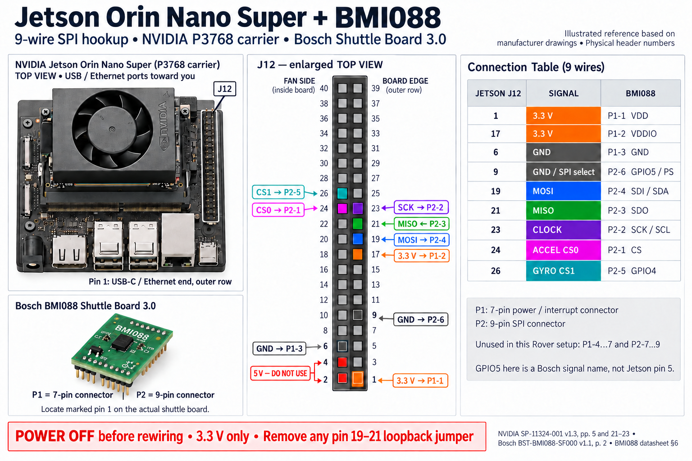
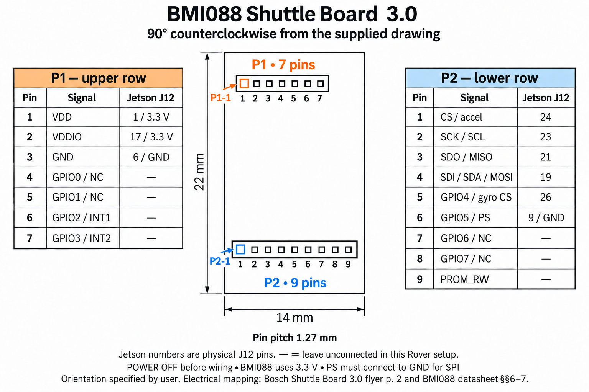

# 실제 차량 연결·설정

2026-10-28 KST 인계 기준. 실행은 [README](../README.md), 설치 식별은 [최종 기록](../data/final_vehicle_2026-10-28/README.md),
회로·BOM·커넥터는 [PCB 원본](#rover-pdb)을 따른다.
숫자 설정은 [config.py](../rover/config.py), 보드별 고정 pulse/핀은 해당 firmware가 원본이다.

## Rover PDB

현재 회로·BOM·커넥터·제작 검증의 원본은 형제 저장소
[PCB/projects/rover-pdb/README.md](../../PCB/projects/rover-pdb/README.md)다. Rover만 받은 경우 실제 보드 revision을 함께 인계받는다.
설계 완료는 조립·부하 검증이 아니다. 오래된 LM73606 설계 pinout/BOM을 현재 보드에 적용하지 않는다.
Rover 설정은 config.py, I/O는 Pico firmware, serial 이름은 jetson/99-rover-serial.rules가 소유한다.
Scout pinout은 해당 Scout CAD와 설치 firmware의 board_pinmap.json/board_pins.h를 대조한다.

## 모터·Pico

| 장치 | 재개 시 확인 |
|---|---|
| U2D2 | `/dev/u2d2`, 중복 실행 없음, 모터 공통 baud와 config 일치 |
| 바퀴 | XH430-V350-R, ID 1–4, Velocity mode, ID/좌우/부호 일치 |
| 실린더 | 같은 U2D2의 ID 5, 수동 jog·해제 HOLD, 자동 끝단 정지 없음 |
| Pico 2 | `/dev/pico`, MicroPython, [main.py](../firmware/pico/main.py) |
| 카메라 | 기록된 Arducam B0201, USB H.264; 실제 모델/노출/시야 확인 |
| 연속회전 서보 | 기록된 FEETECH FS90MGR; 실제 모델·방향·중립·부하 확인 |
| INA226·배터리 | 실제 shunt·pack label·분압/측정을 config와 대조 |

주변 부품 모델은 남아 있던 구성 기록이며 재개 시 실제 장착품을 확인한다. 구매 이력은 설치 증거가 아니다.
모터 reverse와 소프트웨어 부호를 동시에 뒤집지 않는다. SDK의 [4.5 Mbps 지원 수정](../rover/vendor/PATCHES.md)을 유지한다.
모델 사양·전류·회전 encoder만으로 실제 주행 거리·하중·정지를 확정하지 않는다.

PDB의 `LIFT A`/`LIFT B`는 소프트웨어 `WIND`/`RELEASE`, `CAMERA PAN`은 PAN이다.
`SERVO AUX`는 미사용 출력이고 J9 확장 GPIO는 구동하지 않는다. INA226 `ALERT`는 연결되지 않았으며
motor enable 스위치는 Pico 제어 신호가 아니다. 실제 회로 revision을 PCB 원본과 대조한다.

`tools/build_pico_config.py`는 `PICO_FIRMWARE`·`SERVOS`로 독립 실행 main.py 설정 블록을 만든다.
공식 [Pico 2 MicroPython](https://micropython.org/download/RPI_PICO2/)과 Jetson venv의 `mpremote`를 사용한다.
보드 flash는 Jetson 소스 복사와 별개이며 구동을 멈추고 하중을 지지한 작업으로 수행한다.
연결 시 호스트가 `N` 정지 설정을 보내며 Pico는 그 전의 `S` 출력을 거부한다. ASCII 형식은 펌웨어 머리말을 따른다.
전원 투입 시 PWM-off, 명령/setpoint timeout과 firmware watchdog이 있다. USB 무신호 때 실제 서보 정지는 별도 확인한다.
PWM 0은 신호 제거이며 기계적 정지·하중 유지의 보정값이 아니다.

INA226은 signed shunt voltage / `BATTERY_SHUNT_OHM`으로 전류, 전압×전류로 전력을 계산한다.
전압은 shunt 뒤 bus 전압이다. mAh는 순방향 방전이 양수인 순전하 적분이며 측정 공백을 적분하지 않는다.
센서 실패는 unavailable·재시도로 표시한다. 저전압/센서 누락은 모터 잠금이나 전원 차단 조건이 아니다.
개별 셀 보호 기능도 없으므로 실제 pack과 shunt를 독립 측정한다.

## BMI088 연결

**Jetson Orin Nano Super Developer Kit P3768 + Bosch BMI088 Shuttle Board 3.0**용이다.
J12 번호는 **물리 핀 번호**다. Shuttle의 **P1은 7핀 전원/interrupt, P2는 9핀 SPI**다.



제조사 자료 기반 참고 그림이며 실제 배선 사진은 아니다. 실물 J12/P1/P2의 1번 표시를 먼저 확인한다.
USB/Ethernet을 아래로 보면 J12는 오른쪽, 1번은 포트 쪽 바깥 열, 홀수는 바깥 열이다.

| J12 | 신호 | Shuttle Board 3.0 |
|---|---|---|
| 1 | 3.3 V | P1-1 VDD |
| 17 | 3.3 V | P1-2 VDDIO |
| 6 | GND | P1-3 GND |
| 9 | GND / SPI 선택 | P2-6 GPIO5 / PS |
| 19 | MOSI | P2-4 SDI / SDA |
| 21 | MISO | P2-3 SDO |
| 23 | SCK | P2-2 SCK / SCL |
| 24 | accel CS0 | P2-1 CS |
| 26 | gyro CS1 | P2-5 GPIO4 |

전원을 끄고 연결하며 **5 V 핀 2·4를 BMI088에 연결하지 않는다.** loopback용 19–21 점퍼는 제거한다.
현재 polling 구성은 P1-4…7·P2-7…9를 사용하지 않는다. Bosch GPIO4/5는 Jetson 물리 핀 4/5가 아니다.
칩 pad 번호와 Shuttle header 번호를 혼동하지 않는다. P1/P2를 뒤집은 과거 안내를 사용하지 않는다.



위 그림은 사용자 도면을 반시계 90°로 돌린 방향이다. 위 P1·아래 P2 모두 왼쪽이 1번이다.
[배선 자료·출처](../data/imu_wiring_reference_2026-10-15/README.md)에 Bosch/NVIDIA 원본과 hash가 있다.
PDB 커넥터는 [PCB 원본](#rover-pdb)가 소유한다.


## Clegg 설정과 시험

실린더 시작은 조회만 한다. 새 UP/DOWN 입력 때 현재 encoder로 목표를 초기화하고 position mode·profile·bus watchdog·torque를 준비한다.
버튼 해제는 현재 위치의 torque ON HOLD다. `TORQUE OFF`·E-STOP·만료·종료는 torque OFF를 시도하므로 하중을 지지한다.
UP/DOWN은 표시용 `CYLINDER_*_POSITION_RAW`와 무관하게 jog한다. 자동 기계적 끝단 정지는 없다.
전원/encoder 기준 변경 뒤 양쪽 기준을 다시 확인한다. raw·`motor_shaft_deg`는 모터 축이며 linkage 각도·힘이 아니다.
부호·기준 표본·출처는 config의 `CYLINDER_*`가 소유한다.

STRING은 WIND 누름 유지, ARM/RELEASE 각 시간 동작이며 선행 순서를 요구하지 않는다.
현재 화면 ARM은 내부 `drop`, RELEASE는 `rearm`이다. 내부 기록 이름을 임의로 바꾸지 않는다.
PWM·Duration 설정은 다음 입력부터 적용하고 시간 완료를 실제 서보 위치 확인으로 해석하지 않는다.
설정·허용 범위는 `HAMMER_TEST_*`·`SERVOS`가 원본이다.

바퀴를 끄고 실 서보만 점검하려면 rover 작업 폴더에서 `--no-motors --hammer-test`를 쓴다.
실린더 구동에는 `--cylinder-test`도 필요하다. 이 모드는 자동으로 실행할 시작 절차가 아니며 실제 동작 요청이 있을 때 사용한다.
`tools/inspect_lift.py`는 읽기 점검이며 기존 U2D2 사용 프로그램과 동시에 실행하지 않는다.
[ROBOTIS control table](https://emanual.robotis.com/docs/en/dxl/x/xh430-v350/)은 XH430-V350-R 모델용이다.

### Clegg 가속도 무선 계측

실제 보드는 **Arduino Nano RP2040 Connect**이며 Nano 33 IoT와 다르다.
ADXL375 SPI는 Arduino D10=CS, D11=MOSI, D12=MISO, D13=SCK이며 RP2040 GP5/7/4/6에 대응한다.
센서 전원·장착축은 실제 모듈 원본과 대조한다. 현재 구현은 interrupt 없이 FIFO polling한다.
[Pico SDK 무선 firmware](../firmware/clegg_wireless_sdk/README.md)는 취득과 NINA 네트워크 처리를 분리한다.
ODR·SPI·packet·절전 요청·TCP/발견 포트·고정 IP는 config의 `CLEGG_*`가 원본이다.
packet 크기를 늘리는 것은 센서 ODR나 무손실 보장이 아니다. firmware/decoder 버전을 함께 맞춘다.

노트북의 **2.4 GHz WPA2 핫스팟**, `.venv`, ignored `clegg_wifi.local.md`와 같은 자격으로 빌드한 Nano 이미지가 필요하다.
`SSID:`·`Password:` 형식은 builder/실행기가 읽는다. secret header·자격 포함 이미지·Flash 백업은 공개 snapshot에 넣지 않는다.
`tools/build_clegg_wireless_sdk.py`는 config에서 C 설정과 source manifest를 만들며 secret 산출물은 `.venv`에 둔다.
한 센서 TCP에는 한 수신기만 연결한다. USB는 전원·진단용이고 파형은 Wi-Fi로 받는다.
다른 LAN으로 옮길 때는 Nano의 고정 IP/gateway/netmask와 수신 호스트 설정을 함께 변경한다.

원본 byte·sequence·CRC·FIFO/ring 손실·raw count와 nominal g를 함께 기록한다.
시각은 FIFO/설정 표본률을 이용한 추정이며 실제 sample clock 보정과 다르다. nominal g는 영점/축/장착 보정값이 아니다.
수신 종료·단절 뒤 보드 Flash에서 파형을 자동 복구하지 않는다.
실행은 [README](../README.md#clegg실린더), 해석은 [데이터 계약](13_scout_integration.md#nano-iot-clegg-충격과-rover-위치-연결)을 따른다.

#### Clegg Jetson 위치 context

Nano 수신은 노트북에 유지하고 Jetson의 [읽기 전용 서비스](../tools/serve_clegg_context.py)가 기존 세션의 위치 이력을 읽는다.
전체 telemetry 기록이 필요하며 서비스 시작 뒤 새 표본만 사용한다. 같은 포트의 기존 서비스를 중복 실행하지 않는다.
Jetson 저장소 루트에서 실행한다.

```bash
python tools/serve_clegg_context.py --logs logs/sessions --bind 192.168.0.200
```

노트북 Clegg 실행기에 `-ContextHost 192.168.0.200`, station CLI에는 `--clegg-context-host`를 쓴다.
포트·age·시각 이력 한계는 config의 `CLEGG_CONTEXT_*`·`CLEGG_SYNC_*`가 원본이다.
후보의 시각 범위를 같은 run/frame/IMU 세대의 유효 위치 표본이 둘러쌀 때만 참조한다.
없거나 오래되면 unknown 사유를 남긴다. 연결된 Rover 기준 위치는 실제 해머 접촉점과 다르다.
별도 Matplotlib viewer는 기존 수신기의 HTTP GET을 읽으며 Nano TCP를 추가로 열지 않는다.

### 카메라 PAN

출력은 `SERVOS`·`PAN_RIGHT_OFFSET_US`·`PAN_IDLE_PWM_OFF`가 원본이다.
PAN은 새 입력 동안만 출력하고 idle/timeout/종료는 PWM-off다. 변경 시 Pico 설정을 다시 생성하고 호스트·보드 설정을 함께 맞춘다.
`SET 0`·누적 시간은 명령 참고값이며 실제 각도·기계적 제한·원점 검출이 아니다. 영상 측량에는 별도 실제 각도 관측이 필요하다.

## Jumper ESP 연결과 설정

Scout는 Rover Pico/BMI088와 별도 장치다. 회로·전원·커넥터는 해당 Scout CAD revision과
[현재 firmware](../firmware/scout/README.md)의 `board_pinmap.json`·`board_pins.h`를 대조한다.
Rover PDB 인계 문서는 Scout pinout을 대신하지 않는다.

### 네트워크와 USB

Jetson `rover-5G`, Scout `rover-2G`를 같은 LAN에 두고 guest/client isolation을 끈다.
두 Scout의 실제 MAC·IP를 확인하고 DHCP 예약을 권장한다. `--jumper` 순서가 `scout_1`·`scout_2` 슬롯이며 고유 장치 ID가 아니다.
USB 이름도 고유번호가 아니다. 현재 앱·readback 식별은 [최종 인계](../data/final_vehicle_2026-10-28/README.md)를 따른다.
USB는 Wi-Fi 상태/설정·전원용이고 센서는 TCP로 수신한다.
`wifi_config`의 ssid/password·선택적 ip/gateway/netmask는 제어/센서 연결·출력이 없는 상태에서 변경하고 재부팅한다.
암호는 NVS·credential store·ignored 파일에만 둔다. 포트·timeout·기본 주소는 config를 따른다.

### 기구 설정과 보정

J5 pulse는 firmware 고정값이며 실측 축 각도가 아니다. config의 JUMPER_OPERATOR_PROFILES는 호스트 선택 설정의 원본이다.
모터 방향·encoder 부호·전원·실제 하중을 각 보드와 대조한다. 명령/ACK·정지·센서 품질 해석은
[Scout 계약](13_scout_integration.md#지원하는-장치-계약)을 따른다. 센서 INIT OK만으로 최신 데이터나 구동 성공을 판정하지 않는다.
배터리 ADC 환산값은 독립 측정하고 current_adc_mv를 전류 A로 해석하지 않는다.
