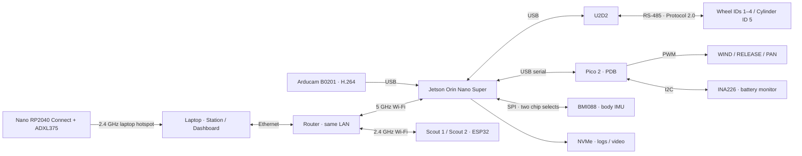
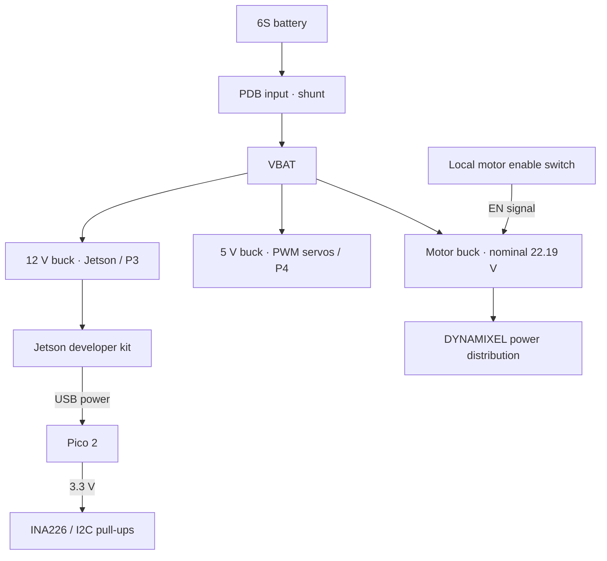
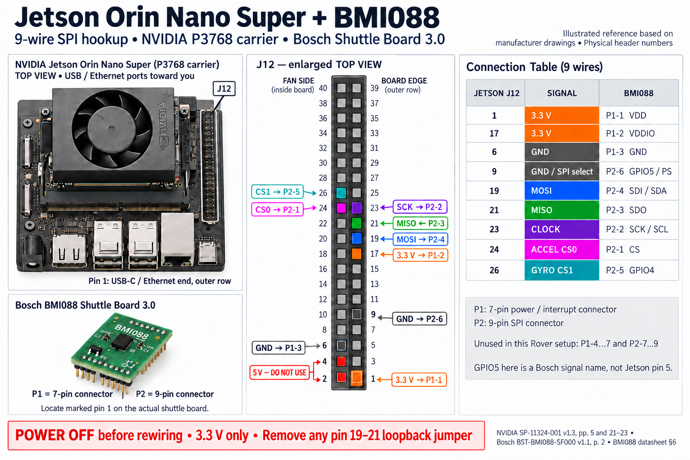
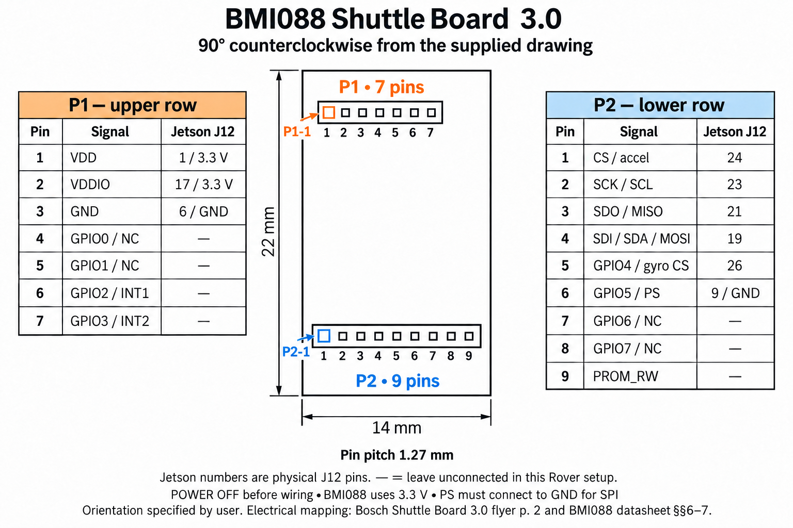

# 전장 시스템과 하드웨어

Rover는 Jetson이 주행·영상·위치 추정을 맡고, U2D2가 DYNAMIXEL을, Pico 2가 소형 서보와 배터리 계측을 연결하는 차량이다.
Scout 두 대와 Clegg 충격계는 각각 자기 보드에서 센서를 읽어 무선으로 데이터를 보낸다.
이 문서는 부품의 역할, 전원과 신호가 지나가는 경로, 연결 방식과 설정의 의미를 설명한다.
운전 순서는 [README](../README.md), 설치·네트워크 명령은 [설치 안내](11_jetson_bringup.md)에 있다.

설명 기준은 현재 저장소 소스와 2026-10-28 인계 기록이다. 아래 설정표는
[config.py](../rover/config.py)를 읽기 쉽게 풀어 쓴 것이며, 값을 바꾸는 곳도 그 파일이다.
회로·BOM·PCB 핀 배치는 [Rover PDB 원본](#rover-pdb), 보드의 고정 동작은 해당 firmware가 소유한다.
여기서 **현재 PDB 설계**는 형제 저장소의 CAD를 뜻한다. 보관 당시 설치된 보드의 revision과
지금 연결된 실물의 상태는 설치 기록·보드 식별로 구분하며, 문서를 갱신한 날짜가 설치 날짜를 뜻하지 않는다.

## 전체 구성



위 그림의 선은 **데이터 경로**다. 모터와 서보 전류는 USB가 아니라 PDB의 전원 레일에서 공급한다.
Nano는 노트북 핫스팟을 사용하므로 Rover·Scout LAN과도 구분된다.

| 계통 | 현재 구성 | 하는 일 | 구현·설정 위치 |
|---|---|---|---|
| 주 연산 | Jetson Orin Nano Super Developer Kit, NVMe | 주행 입력 처리, 영상 전달·기록, BMI088 취득과 추정 | [rover_main.py](../rover/rover_main.py) |
| 주행 | XH430-V350-R 네 개, U2D2 | 좌우 바퀴 속도 명령, encoder·전류 반환 | [motors.py](../rover/motors.py), `WHEELS` |
| 실린더 | U2D2의 DYNAMIXEL ID 5 | 위치 목표를 조금씩 옮기는 jog와 HOLD | [hammer_lift.py](../rover/hammer_lift.py), `CYLINDER_*` |
| 보조 출력 | Pico 2, 연속회전 PWM 서보 | STRING의 WIND/RELEASE와 카메라 PAN | [pico_link.py](../rover/pico_link.py), `SERVOS` |
| 차체 자세 | Bosch BMI088 Shuttle Board 3.0 | 가속도·각속도를 Jetson에 전달 | [imu_reader.py](../rover/imu_reader.py), `BMI088_*` |
| 영상 | Arducam B0201 USB 카메라 | 카메라 안에서 H.264 압축 | [camera.py](../rover/camera.py), `CAMERA_*` |
| 전원·계측 | Rover PDB, INA226, 6S 배터리 | 전압 변환·분배, pack 전압·전류 측정 | [PDB 설계](#rover-pdb), `BATTERY_*` |
| 무선 | Jetson AX210, 공유기, 노트북 Ethernet | 로버 영상·명령·텔레메트리 전달 | [네트워크와 복구](11_jetson_bringup.md#네트워크와-복구) |
| Scout | 별도 ESP32 보드 두 대 | 압축 DC 모터, J5 서보, 자체 센서 취득 | [Scout firmware](../firmware/scout/README.md) |
| Clegg 충격계 | Nano RP2040 Connect + ADXL375 | 해머의 고가속도 파형 수집 | [Clegg firmware](../firmware/clegg_wireless_sdk/README.md), `CLEGG_*` |

### 센서 설정 한눈에 보기

아래는 현재 소스가 요청하는 설정이다. ODR은 센서의 출력 표본률이며, host 수신률이나 무손실 저장률을 뜻하지 않는다.
SPI clock도 요청값이다. 실제 시간 간격과 유실은 각 기록의 timestamp·sequence·상태로 읽는다.

| 센서·역할 | 범위·주기·필터 | 통신 | 설정 원본 |
|---|---|---|---|
| BMI088 가속도계 · 차체 | ±6 g, ODR 400 Hz, OSR4 / 대역폭 약 40 Hz | Jetson SPI0 CS0, mode 3, 요청 1 MHz | `BMI088_ACCEL_RANGE_G`, `BMI088_ACCEL_CONF`, `IMU_RATE_HZ`, `BMI088_SPI_*` |
| BMI088 자이로 · 차체 | ±500 °/s, ODR 400 Hz, 대역폭 47 Hz | Jetson SPI0 CS1, mode 3, 요청 1 MHz | `BMI088_GYRO_RANGE_DPS`, `BMI088_GYRO_BANDWIDTH`, `IMU_RATE_HZ`, `BMI088_SPI_*` |
| ADXL375 · Clegg 해머 | ±200 g, ODR 3,200 Hz, nominal 0.049 g/count | Nano SPI, 요청 2 MHz, FIFO polling | `CLEGG_RATE_REGISTER=0x0F`, `CLEGG_SAMPLE_HZ`, `CLEGG_NOMINAL_G_PER_LSB`, `CLEGG_SPI_HZ` |
| INA226 · pack 계측 | shunt 2 mΩ, Pico 보고 간격 50 ms | Pico I2C 100 kHz, 주소 `0x40` | `BATTERY_SHUNT_OHM`, `PICO_FIRMWARE`의 `REPORT_MS`, `I2C_HZ`, `INA226_ADDRESS` |

BMI088은 차체의 중력 방향과 회전을 읽는 역할이고, ADXL375는 해머에 직접 걸리는 짧고 큰 충격을 읽는 역할이다.
차체의 ±6 g 범위와 해머의 ±200 g 범위를 분리해 쓰므로 한 센서의 파형을 다른 센서의 측정으로 대신하지 않는다.
ADXL375의 범위는 [Analog Devices 부품 사양](https://www.analog.com/en/products/adxl375.html),
nominal 감도와 선택 ODR은 [config.py](../rover/config.py) 및 [Clegg firmware](../firmware/clegg_wireless_sdk/clegg_wireless_sdk.c)에 대응한다.
nominal 감도는 장착된 센서의 교정값이 아니며, INA226의 50 ms는 센서 내부 변환시간이 아니라 Pico의 보고 간격이다.

### 7월 아키텍처 자료와 현재 차량의 관계

초기 자료의 질량·전력·통신 계산 방식은 설계 배경으로 유용하다. 다만 부품과 연결은 개발 중 바뀌었다.
현재 차량을 설명할 때는 아래 오른쪽 구성을 쓴다.

| 초기 설계에 있던 구성 | 현재 소스·설계의 구성 |
|---|---|
| Orin Nano 모듈 + 자체 Carrier PCB | Jetson Orin Nano Super Developer Kit + 별도 전력분배 PDB |
| 휠 네 개 + XC430 보조축 세 개를 U2D2로 제어 | 휠 네 개 + ID 5 실린더는 U2D2, STRING/PAN은 Pico PWM |
| BATT 직결 휠, 12 V 보조축 | PDB의 약 22.19 V motor buck, 12 V Jetson, 5 V 서보 레일 |
| INA226 두 채널 | Pico가 INA226 한 채널로 전체 pack 전류와 shunt 뒤 전압을 읽음 |
| BMI088 상보필터 | BMI088 취득과 ESKF·wheel 위치 적분을 별도 프로세스에서 실행 |
| 해머 ADXL375를 Jetson SPI에 연결 | 해머 ADXL375를 Nano에 연결하고 노트북이 Wi-Fi로 수신 |
| UDP 조종·영상, LTE 보조 링크 | 현재 Station 링크와 H.264 전달, 별도 Scout/Clegg TCP 연결 |

## Rover PDB

PDB는 **Power Distribution Board**, 즉 배터리 전력을 나누고 소형 I/O를 모으는 보드다.
Jetson의 SO-DIMM을 꽂는 carrier board와는 역할이 다르다.
현재 CAD의 입구는 형제 저장소 [PCB/projects/rover-pdb/README.md](../../PCB/projects/rover-pdb/README.md)다.

| 필요한 원본 | 위치 |
|---|---|
| 현재 native schematic·PCB, 조립 그림 | [PDB README](../../PCB/projects/rover-pdb/README.md) |
| 채택한 IC·레일·저항·커패시터와 계산 근거 | [DESIGN_BASIS.md](../../PCB/projects/rover-pdb/DESIGN_BASIS.md) |
| Pico USB 전원, motor enable 스위치 회로 | [POWER_DECISIONS.md](../../PCB/projects/rover-pdb/docs/design/POWER_DECISIONS.md) |
| 구매 부품과 BOM 설명 | [BOM_NOTES.md](../../PCB/projects/rover-pdb/docs/design/BOM_NOTES.md) |
| Rover에서 사용하는 Pico 핀과 역할 | `config.py`의 `PICO_FIRMWARE`, [Pico main.py](../firmware/pico/main.py) |

Rover 폴더만 복사했으면 위 형제 링크의 대상도 함께 있어야 회로와 BOM을 열 수 있다.
현재 PDB의 커넥터 번호에 초기 LM73606 보드의 핀 배치를 적용하지 않는다.
이 문서의 전원 그림은 회로를 읽기 위한 요약이고, 실제 납땜·케이블 핀 순서는 native CAD를 따른다.

### 전원 흐름



| 레일 | 부하 | 읽을 때의 의미 |
|---|---|---|
| VBAT | 세 buck converter 입력 | 배터리에서 shunt를 지난 전압 |
| 약 12 V | Jetson 입력, P3 확장 | P3와 Jetson은 같은 converter의 전류 예산을 공유 |
| 약 5 V | WIND·RELEASE·PAN·AUX, P4 확장 | 서보 동력 전원. Pico USB 전원과 역할이 다름 |
| 약 22.19 V | DYNAMIXEL 배전 | buck의 nominal 목표값. 배터리 전압이 낮아지면 그 값을 유지하지 못함 |
| Pico 3.3 V | INA226·I2C pull-up | Pico의 USB 유래 전원 |

현재 PDB 설계의 converter는 LMR51450 계열이다. 레일별 전압·전류·효율·thermal 계산의 원본은
[설계 근거](../../PCB/projects/rover-pdb/DESIGN_BASIS.md#calculated-checks)에 있다.
부품의 최대 전류 정격, 설계 계산에서 가정한 부하, 실제 차량의 소비전류는 서로 다른 숫자다.

motor enable 스위치는 motor converter의 EN을 제어한다. Pico 명령으로 작동하는 스위치가 아니며,
Jetson·서보 레일까지 모두 끊는 메인 전원 차단도 아니다. 현재 A10 회로에는 onboard F1 퓨즈가 없다.
외부 배터리 하네스의 퓨즈 유무는 보드 BOM만으로 알 수 없다.

### 질량·전력 예산을 읽는 법

현재 구성 기록에는 XH430-V350-R 다섯 개, B0201 한 개, FEETECH FS90MGR 세 개,
6S 2,800 mAh 배터리, 256 GB NVMe, AX210과 ipTIME AX3000Q가 남아 있다.
이는 부품 식별 기록이며 차량 전체를 저울로 잰 질량표는 아니다.

| 합산 대상 | 포함하는 것 | 흔히 빠지는 것 |
|---|---|---|
| 전장 질량 | 모터, Jetson devkit, PDB, 센서, 카메라, 배터리 | 냉각팬·방열판, 서보 브래킷, 커넥터, 케이블, 장착 나사 |
| 배터리 소비전력 | 각 레일의 부하 전력과 converter 손실 | Jetson USB에 붙은 장치의 전력을 별도로 또 더하는 중복 |
| 임무 에너지 | 운용 시간 동안의 소비전력 적분 | 정지·주행·권상 상태의 서로 다른 부하 |
| 저장·무선 부하 | 실제 압축 영상률과 로그량 | 화소 수만으로 저장량을 계산하는 오류 |

초기 자료의 **1,330 g**, **66.5 W**, **44.9 min**은 당시 부품표와 운용 가정을 넣은 설계값이다.
현재 부품 구성이 달라 이 값을 완성 차량의 질량·주행 소비전력·지속시간으로 사용하지 않는다.
배터리 에너지·효율과 질량 합산의 계산 예제는 [전력·질량 예산 계산](01_이론_오도메트리와_ESKF.md#전력질량-예산-계산)에 있다.

## 모터·Pico

### 바퀴와 실린더는 서로 다른 제어 모드다

| 장치 | ID / 출력 | 제어 방식 | 피드백 |
|---|---|---|---|
| 좌전륜 `front-left` | 1 | Velocity mode | 모터축 위치·속도·전류 |
| 우전륜 `front-right` | 2 | Velocity mode | 모터축 위치·속도·전류 |
| 좌후륜 `rear-left` | 3 | Velocity mode | 모터축 위치·속도·전류 |
| 우후륜 `rear-right` | 4 | Velocity mode | 모터축 위치·속도·전류 |
| 실린더 | 5 | Extended Position mode의 jog | 모터축 encoder |
| WIND / RELEASE / PAN | Pico PWM | 연속회전 서보에 pulse 출력 | 실제 축 각도 피드백 없음 |

오른쪽 모터는 거울상으로 장착되므로 소프트웨어의 `WHEEL_SIGN`에서 방향을 바꾼다.
같은 반전을 모터의 `Drive Mode`에도 중복 적용하면 명령과 해석의 부호가 달라진다.
바퀴 배치·좌우 정의는 `WHEELS` 한 곳에서 파생된다.

현재 설정의 바퀴 반지름과 좌우 track width는 `WHEEL_RADIUS_M`, `WHEELBASE_M`이다.
이 프로젝트에서 `WHEELBASE_M`는 앞뒤 축간거리 대신 **좌우 바퀴 간격**을 뜻한다.
encoder는 모터 축이 얼마나 돌았는지를 읽는다. 미끄러짐과 바퀴 변형이 있는 차체의 실제 이동거리와는 구분한다.

### U2D2와 버스

```text
Jetson USB ── U2D2 ── RS-485 데이터 ── PDB 배전 ── 바퀴 1·2·3·4 / 실린더 5
                                             ↑
                                     PDB motor 전원
```

U2D2는 USB 데이터를 DYNAMIXEL 통신으로 변환하며 모터 전원을 공급하지 않는다.
현재 PDB는 U2D2 입력의 전원 핀을 NC로 두고 출력 측에 motor 전원을 합류시킨다.
정확한 핀 순서는 [PDB 설계](../../PCB/projects/rover-pdb/DESIGN_BASIS.md#adopted-circuit),
변환기의 동작은 [ROBOTIS U2D2 설명](https://emanual.robotis.com/docs/en/parts/interface/u2d2/)을 따른다.

호스트 설정은 Protocol 2.0, 공통 baud와 `/dev/u2d2`를 사용한다.
baud는 모터 EEPROM과 호스트 양쪽 값이 같아야 한다. 현재 호스트 값은 `BAUDRATE`이며
벤더 SDK의 [4.5 Mbps 지원 수정](../rover/vendor/PATCHES.md)이 함께 들어 있다.
한 U2D2를 runtime, Wizard, 점검 프로그램이 동시에 열지 않는다.

### 레지스터가 하는 일

EEPROM은 전원을 꺼도 남는 설정이고, RAM은 실행 중 상태와 목표값이다.
모터마다 자기 ID와 상태가 있으므로 같은 버스에 있다는 것과 같은 상태라는 것은 별개다.
주소·단위의 모델 원본은 [XH430-V350-R control table](https://emanual.robotis.com/docs/en/dxl/x/xh430-v350/)이다.

| 영역 | 항목 | 현재 코드에서의 역할 |
|---|---|---|
| EEPROM | ID, Baud Rate | 누구에게 어떤 통신 속도로 말할지 결정 |
| EEPROM | Return Delay Time | 응답 전 대기. 코드의 기대값은 `RETURN_DELAY_TIME_EXPECTED` |
| EEPROM | Drive Mode, Operating Mode | 회전 부호와 제어 종류 |
| RAM | Torque Enable | 출력 허용 여부. OFF는 전원 분리나 기계적 브레이크가 아님 |
| RAM | Goal Velocity | 바퀴 속도 목표 |
| RAM | Present Current / Velocity / Position | 현재 축 상태를 host에 전달 |
| RAM | Hardware Error Status | 모터가 보고한 전압·온도·encoder·전기·과부하 오류 |
| RAM | Bus Watchdog | 모터가 받는 instruction packet 간격을 감시 |

바퀴 초기화는 `torque OFF → Velocity mode 설정·readback → 목표 속도 0 설정·readback → torque ON` 순서다.
실행 중에는 SyncWrite로 네 목표 속도를 보내고, SyncRead로 네 모터의 상태를 읽는다.
실린더는 같은 포트를 공유하지만 별도 제어 경로를 쓴다.

현재 바퀴 초기화 함수는 Bus Watchdog 값을 새로 설정하지 않는다. 실린더의 watchdog 설정은
`HAMMER_LIFT_WATCHDOG_TICKS`에 있다. 제조사 기능 설명이나 초기 설계의 `100 ms`를 전체 축에
적용된 현 상태로 읽으면 안 된다. 모터 watchdog은 브라우저의 새 조작 의도까지 판별하지 않는다.

### 숫자를 어떻게 읽는가

현재 wheel reader는 연속된 전류·속도·위치 영역을 한 번에 읽는다.
단위 환산은 `CURRENT_TO_AMP`, `VELOCITY_TO_RADS`, `POSITION_TO_RAD`에서 한다.

| 원시값 | 처리 | 결과 |
|---|---|---|
| 전류 2 byte | signed int16로 해석 | A |
| 속도 4 byte | signed int32로 해석 | rad/s |
| 위치 4 byte | signed int32로 해석 | rad |

SDK가 반환하는 정수 자체는 unsigned다. 음수 위치가 매우 큰 양수처럼 보이면 2의 보수 해석을 봐야 한다.
또한 `getData()`의 실패 반환도 0이므로 먼저 `isAvailable()`을 확인한다.
현재 구현은 한 wheel 응답이라도 유효하지 않으면 그 cycle 전체를 버린다.
모터 전류는 전기적 측정값이며 stall torque/current 비율 하나로 실제 바퀴 접지력이나 하중을 확정하지 않는다.

### Pico 2가 맡는 출력과 계측

Pico는 Linux 스케줄링과 독립적으로 PWM을 계속 만들고, INA226을 읽는다.
Jetson은 원하는 pulse를 USB serial로 반복 전달한다.

| PDB 표시 | 소프트웨어 역할 | 설정·동작 |
|---|---|---|
| `LIFT A` | `wind` | STRING 권상 |
| `LIFT B` | `release` | STRING ARM/RELEASE |
| `CAMERA PAN` | `pan` | 카메라 좌우 회전 |
| `SERVO AUX` | `aux` | 현재 출력 미사용 |
| INA226 | battery monitor | pack 전압, shunt 전압, 적산 전하 |
| J9 확장 GPIO | 없음 | 현재 firmware가 구동하지 않음 |

`PICO_FIRMWARE`가 GPIO·I2C·PWM 주기·timeout의 원본이다.
[build_pico_config.py](../tools/build_pico_config.py)가 그 값을 standalone
[main.py](../firmware/pico/main.py)의 설정 블록으로 만든다. 호스트 설정 파일 복사와 Pico flash는 별도 작업이다.
MicroPython 이미지는 [Pico 2 공식 다운로드](https://micropython.org/download/RPI_PICO2/)를 사용한다.

| USB 메시지 | 뜻 |
|---|---|
| `?` → `H,...` | protocol·pulse 범위·config identity 조회 |
| `N,wind,release,pan,aux` | stop pulse 설정 후 즉시 정지 출력 |
| `S,wind,release,pan,aux` | 네 채널 pulse 갱신. 먼저 `N`이 있어야 수락 |
| `Z` | 순전하 적산 기준 초기화 |
| `P,...` | 센서 원시값, 출력, 상태 flags 보고 |

`S`의 각 값은 microsecond이고 0은 PWM 신호 제거다. 전원 투입 시에는 PWM-off로 시작한다.
유효한 `S`가 끊기면 firmware가 stop 출력을 적용하며, 조회·잘못된 메시지는 이 시간 제한을 연장하지 않는다.
세부 형식과 flags는 [firmware 머리말](../firmware/pico/main.py)에 있다.

### 배터리 표시의 의미

INA226의 shunt 전압을 `BATTERY_SHUNT_OHM`으로 나누어 전류를 구한다.
현재 PDB에 맞춘 설정은 2 mΩ이며, 시판 INA226 모듈의 shunt와 같다고 가정하지 않는다.
bus 전압은 shunt 뒤 전압이다. 전력은 전압×전류, mAh는 순방향 방전을 양수로 한 순전하 적분이다.
측정이 비는 구간은 적분하지 않고 gap으로 남긴다.

`LOW BATTERY`는 `BATTERY_LOW_V`에 따른 표시다. 모터 잠금, pack 전원 차단, 개별 셀 보호는 하지 않는다.
pack 전압을 `BATTERY_CELLS`로 나눈 값은 셀 평균이며 밸런스 커넥터에서 각 셀을 읽은 결과가 아니다.
Pico USB가 빠지면 Pico와 INA226 계측도 사라지지만 motor 레일은 별도 전원 경로에 있다.

## BMI088 연결

BMI088은 가속도와 각속도를 내는 6축 IMU다. 절대 yaw나 위치를 직접 출력하지 않는다.
Jetson이 데이터를 받아 자세·bias를 추정하고 wheel 속도와 함께 위치를 계산한다.
자세·좌표·ESKF 설명은 [설계와 계산](01_이론_오도메트리와_ESKF.md)에 있다.

이 연결표는 **Jetson Orin Nano Super Developer Kit P3768 + Bosch BMI088 Shuttle Board 3.0**용이다.
J12 번호는 **물리 핀 번호**다. Shuttle의 **P1은 7핀 전원/interrupt, P2는 9핀 SPI**다.



제조사 자료 기반 참고 그림이며 실제 배선 사진은 아니다. USB/Ethernet을 아래로 보면 J12는 오른쪽,
1번은 포트 쪽 바깥 열이고 홀수는 바깥 열이다. 실물의 1번 표시를 기준으로 읽는다.

| J12 | 신호 | Shuttle Board 3.0 |
|---|---|---|
| 1 | 3.3 V | P1-1 VDD |
| 17 | 3.3 V | P1-2 VDDIO |
| 6 | GND | P1-3 GND |
| 9 | GND / SPI 선택 | P2-6 GPIO5 / PS |
| 19 | MOSI | P2-4 SDI / SDA |
| 21 | MISO | P2-3 SDO |
| 23 | SCK | P2-2 SCK / SCL |
| 24 | accel CS0 | P2-1 CS |
| 26 | gyro CS1 | P2-5 GPIO4 |

전원을 끄고 연결한다. **J12의 5 V 핀 2·4를 BMI088에 연결하지 않는다.**
loopback용 19–21 점퍼는 제거한다. 현재 polling 구성은 P1-4…7·P2-7…9를 사용하지 않는다.
Bosch GPIO4/5는 Jetson 물리 핀 4/5가 아니다.



위 그림은 사용자 도면을 반시계 90°로 돌린 방향이다. 위 P1·아래 P2 모두 왼쪽이 1번이다.
[배선 자료·출처](../data/imu_wiring_reference_2026-10-15/README.md)에 Bosch/NVIDIA 원본과 hash가 있다.

### 왜 CS가 두 개인가

가속도계와 자이로는 별개 die와 레지스터 맵을 가진다. MOSI·MISO·SCK를 공유하고 CS로 대상을 고른다.
가속도계에는 SPI 모드 진입과 read dummy byte 처리가 있으며 자이로 read와 같지 않다.
이 차이는 [imu_reader.py](../rover/imu_reader.py)가 처리한다.

현재 설정은 `BMI088_*`에서 SPI mode·요청 clock·range를, `IMU_RATE_HZ`에서 표본률을 정한다.
자이로 FIFO의 여러 표본을 한 번에 전달할 수 있으며 가속도는 최신 filtered reading을 함께 쓴다.
따라서 host의 수신 주기와 센서의 표본 주기는 같은 개념이 아니다.

`BMI088_IMU_TO_BODY`는 센서축을 차체축으로 바꾼다. 현재 장착 설명은 센서 +Y가 전방, +X가 우측, +Z가 위다.
시작·`NEW RUN`의 정지 정렬은 gyro bias와 roll/pitch를 잡고 당시 정면을 yaw 0으로 삼는다.
IMU 재연결과 데이터 유실 표시는 주행 입력 처리와 독립적이다.

## 카메라 선정과 영상 경로

현재 카메라는 **Arducam B0201**이다. 선택의 핵심은 광각과 저조도 특성, 그리고 **카메라 자체 H.264 출력**이다.
Orin Nano에는 NVENC가 없기 때문에 이 스트림을 그대로 전달하면 Jetson에서 다시 압축할 필요가 없다.
이는 [NVIDIA의 Orin Nano 인코딩 설명](https://docs.nvidia.com/jetson/archives/r36.4.4/DeveloperGuide/SD/Multimedia/SoftwareEncodeInOrinNano.html)과
[현재 camera.py](../rover/camera.py)의 구조에 대응한다.

| B0201 항목 | 문서·현재 구현 기준 | 읽을 때의 의미 |
|---|---|---|
| 센서 | Sony IMX291, 2 MP급, 2.9 µm pixel | 화소 수와 pixel pitch를 함께 봄 |
| 렌즈 | M12, 공칭 대각 FOV 120° | 수평 FOV 120°라는 뜻은 아님 |
| DR | 제조사 표기 80 dB | 특정 장면에서 그만큼 식별 가능하다는 보장은 아님 |
| 출력 | USB UVC, H.264 지원 | 현재 연결한 H.264 node를 선택 |
| 현재 요청 영상 | `CAMERA_WIDTH/HEIGHT/FPS` | 기본 1920×1080, 30 fps |
| 압축률 | 기존 통합 기록에서 약 10 Mbit/s | 현재 코드는 bitrate를 별도로 설정하지 않음 |
| 노출 관련 설정 | `CAMERA_MAINS_HZ` | 시작 시 조명 flicker 주파수 설정. 노출 수동 고정 기능과 다름 |

부품 사양은 [Arducam B0201 datasheet](https://www.uctronics.com/download/Amazon/B0201_IMX291_120_UVC_Camera_Datasheet.pdf)와
[공식 선정표](https://docs.arducam.com/UVC-Camera/USB2-UVC-Camera-Kit/Specs-and-Selection-Guide/)에서 확인할 수 있다.
실제 지원 포맷은 연결 장치가 보고하는 UVC format과 선택한 video node가 기준이다.

### 카메라를 비교할 때 보는 순서

| 판단 항목 | 로버에서 중요한 이유 | 비교할 정보 |
|---|---|---|
| 시야·장착 | 가까운 지면, 양쪽 장애물, 차체 일부가 함께 보여야 조종하기 쉬움 | 실제 HFOV, 렌즈 왜곡, 장착 높이·기울기, 고정 방식 |
| 출력 포맷·인코더 | 무선 전송과 host CPU 사용량을 좌우 | 원하는 해상도에서 H.264/MJPEG/YUYV 지원 여부 |
| fps·노출·지연 | 움직이는 동안 흐림과 제어 지연을 결정 | fps, exposure time, encoder·network·display buffering |
| pixel pitch·렌즈 | 픽셀당 수광량과 광학 선명도에 영향 | pitch, f-number, 렌즈 성능, IR filter |
| DR·ISP | 밝은 바닥과 그림자에서 정보가 유지되는지 결정 | DR 측정 조건, AE/AWB, gain, sharpening |
| bitrate·압축 | 같은 1080p여도 돌·모래의 세부가 사라질 수 있음 | 실제 전송률, GOP, 장면의 움직임·질감 |
| 질량·배선 | 카메라보다 mount·케이블이 더 큰 부담이 되기도 함 | 보드/케이스/케이블을 포함한 질량, connector 방향 |
| 화소 수 | 최종 화면과 필요한 판독 거리의 요구를 충족 | 출력 해상도, crop·다운샘플링 방식 |

픽셀이 크면 같은 조건에서 픽셀 하나가 받는 빛을 늘릴 수 있다. 그러나 화질은 센서 면적·양자효율·노이즈·렌즈·노출·리사이즈까지 함께 결정한다.
따라서 `2.9 µm는 항상 좋고 1.1 µm는 항상 나쁘다`처럼 한 숫자로 순위를 고정하지 않는다.
마찬가지로 `1080p는 8 Mbit/s면 충분`이라는 판정은 정지 장면과 빠르게 움직이는 모래 장면에서 달라진다.

15 fps의 프레임 간격은 약 67 ms, 30 fps는 약 33 ms다. 이것은 전체 조종 지연이 아니라 그 구성요소 하나다.
rolling shutter의 왜곡도 차속만 아니라 진동·각속도·readout 시간에 좌우된다.
USB VID/PID는 장치 식별 단서이며 H.264 지원 여부를 대신하는 검사가 아니다.

`1/2.8 inch`는 광학 포맷명이라 이를 25.4로 곱해 센서 대각선으로 쓰지 않는다.
120° 대각 FOV를 16:9 직선 투영으로 환산하면 수평 약 113°지만, 실제 광각 렌즈의 왜곡·crop은 이 근사와 다를 수 있다.
시야폭·GSD·물체가 차지하는 pixel 수·bitrate 저장량의 계산은
[카메라 시야와 영상량 계산](01_이론_오도메트리와_ESKF.md#카메라-시야와-영상량-계산)에 있다.

### 현재 영상이 저장되는 방식

```text
B0201 H.264 node → GStreamer parser → 압축 frame
                                      ├─ Station 전달 → Dashboard 영상
                                      └─ Jetson recorder → logs/video/.../*.ts
```

미리보기와 로컬 기록은 같은 압축 frame을 받는다. 해상도를 줄여도 bitrate가 자동으로 줄어든다고 가정하지 않으며,
현재 구현에는 기록만 12–16 Mbit/s로 높이는 별도 encoder 설정이 없다.
기록은 `VIDEO_*`, 장치 선택은 `CAMERA_DEVICE`가 소유한다.
설치와 video node 확인은 [Jetson 안내](11_jetson_bringup.md), 파일과 누락 해석은 [데이터 계약](13_scout_integration.md)을 따른다.

<a id="clegg-설정과-시험"></a>

## Clegg 설정과 동작

### 실린더와 STRING의 역할

실린더는 ID 5 DYNAMIXEL이고, STRING은 Pico에 연결된 연속회전 서보다.
화면에 함께 있어도 출력 장치와 정지 방식이 다르다.

| 조작 | 출력 동작 | 버튼을 놓거나 시간이 끝나면 |
|---|---|---|
| 실린더 `UP` / `DOWN` | 현재 encoder에서 출발해 목표를 계속 앞당김 | 현재 위치를 torque ON으로 HOLD |
| 실린더 `TORQUE OFF` | 모터 torque 해제 | 하중 유지 없음 |
| STRING `WIND` | 누르는 동안 설정 PWM | stop 출력 |
| STRING `ARM` | 내부 action `drop`, 설정 시간 동안 PWM | stop 출력 |
| STRING `RELEASE` | 내부 action `rearm`, 설정 시간 동안 PWM | stop 출력 |

실린더 시작은 상태 조회이며, 새 jog 입력에서 mode·profile·watchdog·torque를 준비한다.
`CYLINDER_UP_POSITION_RAW`·`CYLINDER_DOWN_POSITION_RAW`는 표시 기준이다. jog의 기계적 끝단 제한이 아니다.
`raw`·`motor_shaft_deg`는 모터 축 좌표이고 linkage 길이·해머 높이·힘을 직접 뜻하지 않는다.
E-STOP·입력 만료·종료 경로는 torque OFF를 시도하므로 하중을 지지한 상태에서 다룬다.

STRING은 선행 순서를 요구하지 않는다. PWM·Duration 변경은 다음 입력부터 적용한다.
설정과 허용 범위는 `HAMMER_TEST_*`, `SERVOS`에 있으며 시간 완료는 실제 위치 도달 신호가 아니다.
보드 silk의 LIFT A/B 이름과 화면 WIND/RELEASE 이름이 다른 이유도 이 역할 변경 때문이다.

`--no-motors --hammer-test`는 wheel을 열지 않고 STRING을 사용하는 mode다.
실린더도 쓰는 mode에는 `--cylinder-test`가 더 필요하다. 이 인자는 구동 가능한 실행 mode이지 자동 점검 절차가 아니다.
[inspect_lift.py](../tools/inspect_lift.py)는 읽기 도구이며 기존 U2D2 소유 프로그램과 동시에 실행하지 않는다.

### Clegg 가속도 무선 계측

실제 보드는 **Arduino Nano RP2040 Connect**다. Nano 33 IoT나 Rover의 Pico 2와 다른 장치다.
ADXL375는 해머에 실리는 고가속도 센서이며, 본체 BMI088의 자세 센서와도 역할이 다르다.

| ADXL375 SPI 신호 | Nano Arduino 이름 | RP2040 GPIO |
|---|---|---|
| CS | D10 | GP5 |
| MOSI | D11 | GP7 |
| MISO | D12 | GP4 |
| SCK | D13 | GP6 |

전원·GND·축 방향은 실제 ADXL375 모듈의 회로와 장착 방향을 따른다.
현재 구현은 interrupt 없이 FIFO polling한다. ODR·SPI clock·packet 크기는 `CLEGG_*`가 원본이다.
[Pico SDK firmware](../firmware/clegg_wireless_sdk/README.md)는 취득과 NINA Wi-Fi 처리를 분리해 sensor FIFO와 network가 직접 묶이지 않게 한다.

```text
ADXL375 → Nano sensor FIFO / ring → NINA Wi-Fi → Laptop Clegg receiver
                                                  ├─ 원본·metadata 저장
                                                  └─ HTTP → 별도 Plot viewer
```

노트북의 2.4 GHz WPA2 핫스팟과 Nano 이미지의 네트워크 설정이 한 쌍이다.
자격은 ignored `clegg_wifi.local.md`의 `SSID:`·`Password:`로 관리한다.
[builder](../tools/build_clegg_wireless_sdk.py)가 source manifest와 C 설정을 만들고,
secret header·자격 포함 이미지는 공개 자료에 넣지 않는다. 고정 주소·gateway·netmask는 `CLEGG_WIFI_*`에 있다.

한 센서 TCP에는 한 수신기만 연결한다. USB는 전원·진단용이고, 파형 viewer는 수신기의 HTTP를 읽는다.
viewer를 닫아도 수신은 계속되며 Nano TCP를 추가로 열지 않는다.
원본 byte·sequence·CRC·FIFO/ring 손실·raw count와 nominal g를 함께 남긴다.
nominal g는 장착축·영점 보정 결과가 아니며, FIFO와 설정 표본률로 구성한 시각도 실제 clock 보정과 구분한다.
수신이 끝난 뒤 Nano Flash에서 파형을 자동 복구하는 기능은 없다.

실행은 [README](../README.md#clegg실린더), 파일·시각·충격 후보 해석은
[Clegg 데이터 계약](13_scout_integration.md#nano-iot-clegg-충격과-rover-위치-연결)에 있다.

#### Clegg Jetson 위치 context

Nano의 파형 수신은 노트북에서 유지한다. Jetson의 [context 서비스](../tools/serve_clegg_context.py)는
기존 telemetry의 위치 이력을 읽고 Clegg 수신기에 전달한다. 서비스는 차량에 새 주행 명령을 보내지 않는다.
실행·연결 명령은 [설치 안내](11_jetson_bringup.md)를 따른다.

충격 후보 시각을 같은 run/frame/IMU 세대의 유효 위치 표본이 둘러쌀 때만 위치를 연결한다.
자료가 없거나 오래되면 `Unknown` 사유를 남긴다. 연결되는 좌표는 Rover의 기준점이며 실제 해머 접촉점으로 자동 변환되지 않는다.
조건과 시간 범위 설정은 `CLEGG_CONTEXT_*`, `CLEGG_SYNC_*`에 있다.

### 카메라 PAN

PAN은 연속회전 서보에 pulse를 보내는 방식이다. 위치 서보처럼 목표 각도를 보내지 않는다.
`SERVOS`, `PAN_RIGHT_OFFSET_US`, `PAN_IDLE_PWM_OFF`가 방향·출력·idle을 정한다.
새 입력 동안만 출력하고 idle·timeout·종료는 PWM-off다.
설정을 바꾸면 Pico 생성 설정과 host 설정을 함께 맞춘다.

화면의 `SET 0`와 누적 시간은 조작 참고값이다. encoder·기계 원점·자동 끝단 제한은 없으므로
영상에서 보는 방향과 케이블 장력을 기준으로 조작한다.

## Jumper ESP 연결과 설정

Scout는 별도 전원·구동·센서를 가진 소형 차량이다. Rover의 Pico, 본체 BMI088, Clegg Nano와 같은 장치로 취급하지 않는다.
호스트에서는 과거 이름 `jumper`가 파일·설정 이름에 남아 있고, 화면에서는 `Scout`를 사용한다.

| 구성 | 역할 | 원본 |
|---|---|---|
| DC motor·encoder | 압축·해제 회전, 회전량 반환 | [actuators.c](../firmware/scout/v12_4_control_link/esp/main/actuators.c) |
| J5 servo | LOCK / LAUNCH / PULL 위치 출력 | 같은 firmware의 고정 pulse |
| ICM45605 | 관성 데이터 | [센서 취득](../firmware/scout/v12_4_control_link/esp/main/sensors.c) |
| ADXL375·MMC5983MA | 고가속도·자기 센서 데이터 | 같은 센서 구현 |
| Wi-Fi control/data | 명령과 센서 stream | [network.c](../firmware/scout/v12_4_control_link/esp/main/network.c) |
| GPIO 배치 | 보드와 firmware 사이 대응 | [board_pins.h](../firmware/scout/v12_4_control_link/esp/board_pins.h) |

Scout 회로·커넥터는 해당 Scout CAD revision이 원본이다. Rover PDB 문서의 핀 배치로 대신하지 않는다.
현재 앱 식별과 보드별 설치 자료는 [firmware 안내](../firmware/scout/README.md),
[최종 인계](../data/final_vehicle_2026-10-28/README.md)에 있다.

### 네트워크와 USB

Jetson `rover-5G`와 Scout `rover-2G`는 같은 공유기의 LAN에 있다.
`--jumper` 순서가 `scout_1`·`scout_2` 화면 슬롯을 정하며 그 이름 자체가 보드의 고유 ID는 아니다.
보드는 MAC·IP와 설치 식별로 구분한다. USB 포트 이름도 고유 장치 ID가 아니다.

USB는 Wi-Fi 설정·진단·전원용이고 현재 센서 stream은 TCP로 받는다.
`wifi_config`의 SSID·password·고정 주소는 연결·출력이 없는 상태에서 변경 후 재부팅하는 설정이다.
암호는 NVS·credential store·ignored 파일에 둔다.
구체적인 LAN 구성·주소·복구 순서는 [설치와 복구](11_jetson_bringup.md), 메시지와 포트 계약은
[Scout 계약](13_scout_integration.md#지원하는-장치-계약)에 있다.

### 기구 설정과 보정

J5 pulse는 firmware의 출력 명령이며 실제 축 각도를 센서로 읽은 값이 아니다.
`JUMPER_OPERATOR_PROFILES`는 호스트에서 선택하는 설정의 원본이다.
DC 회전과 J5 위치는 독립적으로 유지되므로 `LOCK`이 DC 정지 명령을 뜻하지 않는다.
`COMPRESS`·`DECOMPRESS`는 버튼을 놓아도 계속되며 `STOP ROTATION`으로 멈춘다.

encoder counts는 축 회전량이고 점프 높이·압축력·착지 위치가 아니다.
`current_adc_mv`는 ADC 전압 이름 그대로 읽으며 곧바로 전류 A로 바꾸지 않는다.
ACK, sensor 상태, 실제 점프 사건을 구분하는 기록 방법은 [차량 데이터 계약](13_scout_integration.md)에 있다.

## 배선과 상태를 읽는 기본 원칙

| 구분 | 현재 차량에서의 적용 |
|---|---|
| 동력과 신호 | 모터·서보 전류는 PDB 레일, USB·SPI·I2C는 제어·측정 경로 |
| 공통 기준 | 데이터선을 연결할 때 해당 회로의 GND 경로도 함께 읽음 |
| 핀 번호 | Jetson J12 물리 핀, Pico GP 번호, Arduino D 이름, IC pad 번호를 구분 |
| 장치 이름 | `/dev/u2d2`, `/dev/pico`, camera by-id는 [udev 규칙](../jetson/99-rover-serial.rules)과 장치 설정을 따름 |
| 배선 방향 | 커넥터 정면·후면, PCB 위·아래 관찰 방향에 따라 좌우가 바뀜 |
| 하네스 | 전원선의 전류·전압과 신호선 역할은 현재 CAD·실제 cable 규격으로 판단 |
| 명령과 동작 | host 송신·ACK·encoder 변화는 서로 다른 단계의 정보 |
| 저장된 값과 새 값 | sensor 수신 시각·age·오류 표시를 함께 봄 |

포트가 안 열리거나 장치가 보이지 않을 때의 명령은 [설치 안내](11_jetson_bringup.md)에 모아 두었다.
운전 중 정지·단절 대응은 [README](../README.md#단절종료기록)를 따른다.
